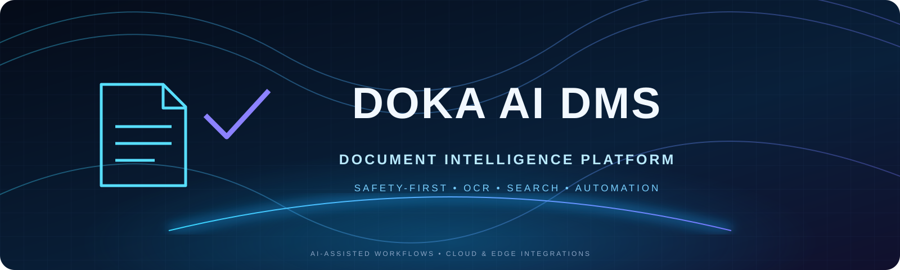

<p align="center">
  
</p>

<h1 align="center">Doka AI DMS</h1>
<p align="center"><strong>Safety-first document management and AI-assisted knowledge workflows.</strong></p>

<p align="center">
  <a href="https://github.com/dokaaidms/doka-ai-dms/actions"></a>
  
  
  
  
</p>

<p align="center">
  <a href="https://github.com/dokaaidms/doka-ai-dms/issues">Issues</a> ·
  <a href="https://github.com/dokaaidms/doka-ai-dms/actions">CI workflows</a> ·
  <a href="https://t.me/DokaAiDmsBot">Telegram bot</a>
</p>

---

## Overview

**Doka AI DMS** is a document management and knowledge-work platform designed to help organize documents, extract useful information, and connect secure application services. The repository contains a web frontend, Python backend components, Cloudflare Worker integration, and Supabase database assets.

The project is under active development. Features described below distinguish implemented foundations from integrations that still require end-to-end validation; a dependency or UI screen alone is not evidence that a production workflow is operational.

## Product goals

- **Safe document handling** — preserve source files and validate copies before processing.
- **Document understanding** — support OCR and structured extraction workflows.
- **Searchable knowledge** — organize extracted content for retrieval and review.
- **Human review** — keep important document decisions inspectable.
- **Connected infrastructure** — integrate frontend, edge routing, backend services, database, and storage.

## Technology

| Area | Technology |
|---|---|
| Web application | Next.js, React, TypeScript |
| API and processing | Python, FastAPI |
| Edge/API routing | Cloudflare Workers |
| Database and authentication | Supabase / PostgreSQL |
| Cache and supporting services | Upstash Redis |
| Deployment and CI | Vercel, Render, GitHub Actions |
| Messaging integration | Telegram Bot API |

## Architecture at a glance

```text
                 Web application
                 Next.js frontend
                       |
                       v
             Cloudflare Worker / API
                 |           |
                 v           v
          Supabase DB     Backend services
          Auth / RLS      Python / FastAPI
                 |           |
                 +-----+-----+
                       |
              Document processing
              OCR / extraction / review
```

This is a logical component view, not a claim that every route or processing path is currently live in production.

## Current implementation notes

- The frontend and backend are separate applications with independent local setup.
- Cloudflare Worker configuration and deployment automation are maintained separately from the FastAPI development server.
- Supabase migrations and database policies are versioned in the repository.
- Telegram currently serves as a bot integration for status/notification routing. Full document ingestion, OCR, AI summaries, and conversational commands must not be considered production-ready until their end-to-end tests pass.
- OCR benchmark results are intentionally not published until a real benchmark run has produced a verified report.

## Local development

The frontend and Python API are maintained as separate applications.

**Frontend — terminal 1**

```bash
cd apps/web-platform/frontend
npm ci
npm run dev
```

**Backend API — terminal 2**

```bash
cd apps/web-platform/backend
python -m venv .venv
# Activate the virtual environment, then:
python -m pip install -r requirements-local.txt
uvicorn app.main:app --reload
```

The Cloudflare Worker has its own configuration in `wrangler.jsonc`. Follow the repository's Worker workflow and environment documentation for that runtime; the FastAPI command above does not start the Worker.

## Quality and verification

Use the repository's GitHub Actions workflows as the source of truth for automated checks. A green unit-test result does not replace integration testing against staging services. Before release, validate:

- frontend lint, tests, and production build;
- backend tests and API contracts;
- database migration and rollback procedures;
- Worker-to-backend and Worker-to-Supabase authorization paths;
- storage provider behavior and failure handling;
- Telegram topic isolation and webhook delivery;
- OCR benchmarks using real, privacy-safe fixtures.

Do not add fabricated benchmark numbers or claim a workflow is live without a passing end-to-end test.

## Documentation

Project documentation is maintained under [`docs/`](docs/). Important operational guides and migration notes should be added alongside the implementation they describe.

## Contributing

1. Open an issue describing the bug or proposed change.
2. Keep changes focused and include regression tests.
3. Never commit credentials, tokens, private documents, or production data.
4. Document operational and migration impact in the pull request.

---

<p align="center"><strong>Built by Doka · Building ideas into real-world software.</strong></p>
